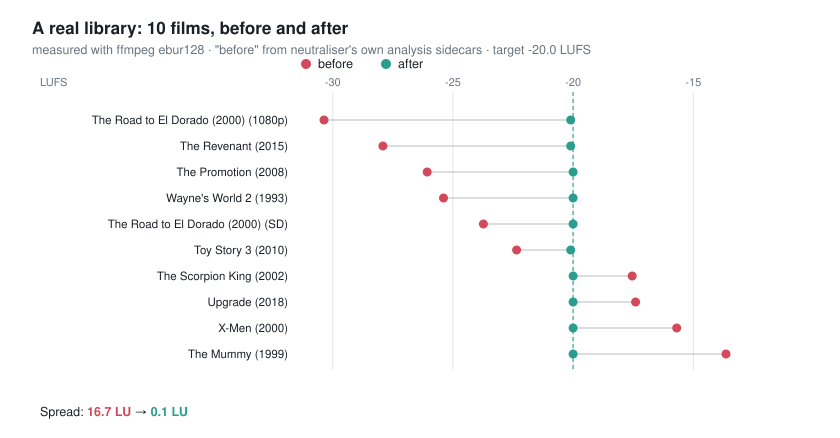
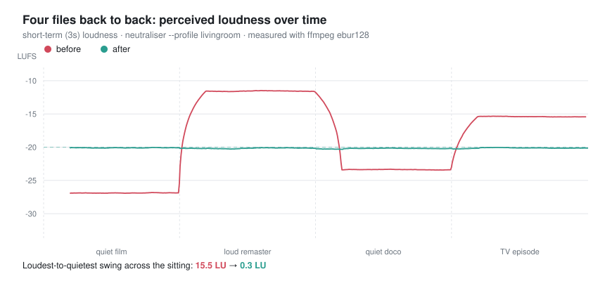
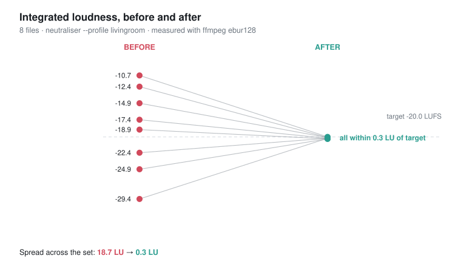

# Neutraliser

**Stop reaching for the remote between every film.** Neutraliser levels the audio across your whole video library — one CLI, no server, no database, no plugin marketplace.

It uses FFmpeg's EBU R128 `loudnorm` filter to bring every file to the same perceived loudness, re-encoding audio at the source's own codec and bitrate so you don't pay for levelling with quality.

```bash
neutraliser process /media/movies --profile livingroom
```

## What it actually does

Ten films from a real 800-film Plex library, before and after — **16.7 LU of spread reduced to 0.1 LU**:



Nothing here is staged. The "before" figures are what Neutraliser recorded in its own
analysis sidecars when it first saw each file; the "after" is an independent `ebur128`
measurement of those same files today. `demo/real_library.rb` builds this from any
library Neutraliser has run over — [the method is documented](demo/README.md).

Across that whole library, **716 of 804 films (89%) now sit within 1 LU of the target**.
The remainder are files added since the last run — which is what `--resume` and the
skip-already-normalised sidecars are for.

Four files played back to back — the loud remaster after the quiet film is the moment you reach for the remote:



And the same again on synthetic clips, if you'd rather run it yourself than trust someone else's library — 8 files spread over ~19 LU:



Don't take the charts' word for it. [`demo/run.rb`](demo/README.md) and
[`demo/ab.rb`](demo/README.md) regenerate both from scratch, `--source ~/media/movies`
runs them over your own library (on copies; originals untouched), and `ab.rb` also
writes `before.mkv`/`after.mkv` so you can *listen* rather than squint at a line.
Loudness is measured with ffmpeg's `ebur128` filter, not the `loudnorm` filter
Neutraliser uses to decide — so it isn't grading its own homework.

**On a real film clip** at −34.9 LUFS (a 14.7 LU boost — the kind of correction where
artifacts would show up if they were going to):

| | before | after |
|---|---|---|
| Integrated loudness | −34.9 LUFS | −20.2 LUFS |
| Loudness range (LRA) | 12.5 LU | **12.5 LU** — unchanged |
| True peak | −17.8 dBFS | −3.0 dBFS — still clear of the −1.5 dBTP ceiling |
| Audio codec | AAC 162k | AAC 162k |
| Video bitstream | — | **MD5-identical**, stream-copied |

Constant gain, not compression: the dynamic range is preserved exactly, so quiet
scenes stay quiet relative to loud ones. Only the overall level moves.

## Why this exists

Plex's own "Normalize Multi-Channel Audio" setting doesn't fix it — it doesn't touch dynamic range within a file and doesn't apply to every client. The usual workarounds are client-side band-aids (soundbar night mode, Windows loudness equalisation) or a full transcode-automation platform like Tdarr, which people accurately describe as powerful but annoying to set up for one job.

Neutraliser does the one job: make the library level, leave everything else alone.

## Features

- **Whole-library levelling** — point it at a directory; it walks it, analyses, and normalises
- **Home-theatre profiles** — `reference`, `livingroom`, `night`, tuned for how you're actually listening
- **Source-matched codec & bitrate** — AAC 512k stays AAC 512k; FLAC stays lossless. No fixed 256k downgrade, no generational decay ([ADR-0001](docs/design/adr/0001-smart-codec-selection.md))
- **Full stream preservation** — every audio/subtitle track, per-stream metadata (titles, languages), chapters and dispositions survive the round trip
- **Safe by default** — writes `*_normalized` copies; originals untouched unless you pass `--replace`
- **Skips what's already fine** — a `.neutraliser` sidecar plus an optional 30-second sample check means a re-run over a processed library costs seconds, not hours
- **Resumable** — interrupted a 500-file run? `--resume` picks up from the manifest
- **Plex-aware** — `analyze-plex` gives a quick loudness triage across your Plex libraries before you change a single file
- **Big-batch friendly** — `--fast` (single-pass, ~30% quicker) and `--local-stage` for slow network mounts

## Requirements

- **Ruby** 3.2+
- **FFmpeg** 4.2+ (with `ffprobe`) on your `PATH`
- *(Optional)* a Plex token in `.env` for `analyze-plex`

Check FFmpeg with `ffmpeg -version`. On macOS: `brew install ffmpeg`. On Debian/Ubuntu: `sudo apt install ffmpeg`.

## Installation

Neutraliser is **run from source** for v0.1 — it isn't on RubyGems yet.

```bash
git clone https://github.com/willhs/neutraliser.git
cd neutraliser
bundle install
bundle exec neutraliser --help
```

Every example below is written as `neutraliser …`; prefix with `bundle exec` when running from the clone.

<details>
<summary>Prefer a real <code>neutraliser</code> on your PATH?</summary>

Build and install the gem locally:

```bash
gem build neutraliser.gemspec
gem install ./neutraliser-0.1.0.gem
neutraliser --help
```

</details>

A RubyGems release (and possibly a Homebrew tap) will follow once v0.1 has had some real-world mileage — see [CHANGELOG.md](CHANGELOG.md).

## Quick start

```bash
# See what a file's loudness actually is — changes nothing
neutraliser process --dry-run movie.mkv

# Normalise one file (writes movie_normalized.mkv alongside it)
neutraliser process movie.mkv

# Normalise a whole library
neutraliser process /media/movies

# ...in place, once you trust it
neutraliser process --replace /media/movies
```

`process` is the default command, so `neutraliser movie.mkv` works too.

## Examples

**Audit before you commit.** Get a rough sense of the spread across a Plex library:

```bash
neutraliser analyze-plex --library "Movies" --output-format table
```

Treat the output as a rough triage tool, not a verdict — it judges each title from a
60-second sample, which can sit several LU from the film's true integrated loudness.
`process` measures files in full.

**Dry-run a directory** to see which files would be touched and by how much:

```bash
neutraliser process --dry-run /media/tv/some-series
```

**Level a large library overnight**, in place, at the faster single-pass setting:

```bash
neutraliser process --replace --fast /media/movies
```

**Resume after an interruption** — a dropped SMB mount, a reboot, a Ctrl-C:

```bash
neutraliser process --replace --fast --resume /media/movies
```

**Night listening** — a tighter dynamic range so quiet dialogue stays audible without explosions waking the house:

```bash
neutraliser process --profile night --replace /media/movies
```

**Hit an exact LUFS target** instead of a named profile:

```bash
neutraliser process --target-level -18.0 movie.mkv
```

**Be stricter about what counts as "already fine"** (default tolerance is 1.0 LU):

```bash
neutraliser process --tolerance 0.5 /media/movies
```

**Processing over a slow or high-latency mount?** Stage files to local disk first:

```bash
neutraliser process --local-stage --replace /mnt/nas/movies
```

**Re-run over an already-levelled library.** Sidecars make this cheap — it's safe to schedule as a cron job that catches newly added files:

```bash
neutraliser process --replace --fast /media/movies
```

## Profiles

| Profile | Target | True peak | LRA | Use it for |
|---|---|---|---|---|
| `reference` | −23 LUFS | −1.5 dBTP | unlimited | Full home-theatre / AVR setups where you want the mix's original dynamics |
| `livingroom` *(default)* | −20 LUFS | −1.5 dBTP | 12 | TVs and soundbars — general viewing. Start here |
| `night` | −16 LUFS | −1.5 dBTP | 10 | Quiet listening: louder overall, compressed range, no explosive peaks |

Higher (less negative) LUFS = louder. Lower LRA = less difference between the quietest and loudest moments.

```bash
neutraliser profiles --verbose
```

Any numeric `--target-level` overrides the profile's LUFS while keeping the rest of its settings.

## How it works

1. **Skip check** — a `.neutraliser` sidecar (size + mtime + profile) says whether this exact file has already been done. If not, an optional 30-second sample estimates whether it's already within tolerance.
2. **Measure** — an FFmpeg `loudnorm` analysis pass measures integrated loudness, true peak, and loudness range. Results are cached, so re-analysis is free.
3. **Decide** — within `--tolerance` of the profile target? Skip it. Otherwise, pick an output codec that matches the source ([ADR-0001](docs/design/adr/0001-smart-codec-selection.md)).
4. **Normalise** — a second `loudnorm` pass applies a constant linear gain using the measured values. Video is stream-copied — it is never re-encoded. Chapters, subtitles, and per-stream metadata are mapped across explicitly.
5. **Write** — atomically, to `*_normalized.<ext>` or over the original with `--replace`, and the sidecar is stamped.

Use `--fast` to collapse steps 2 and 4 into a single dynamic-mode pass: roughly 30% quicker, marginally less precise ([ADR-0002](docs/design/adr/0002-performance-flags.md) has the benchmarks).

## Commands

### `process PATH`

Normalise a file or every video under a directory.

| Option | Default | Description |
|---|---|---|
| `--profile` | `livingroom` | `reference`, `livingroom`, or `night` |
| `--target-level` | — | Explicit LUFS target, overriding the profile |
| `--tolerance` | `1.0` | Skip files already within this many LU of target |
| `--replace` | `false` | Overwrite originals instead of writing `*_normalized` copies |
| `--dry-run` | `false` | Analyse and report only; write nothing |
| `--cache` / `--no-cache` | on | Cache loudness analysis results |
| `--fast-verify` / `--no-fast-verify` | on | Use the 30-second quick sample before a full analysis |
| `--resume` | `false` | Skip files already completed per `.neutraliser-run-manifest.jsonl` |
| `--fast` | `false` | Single-pass normalisation — quicker, slightly less accurate |
| `--local-stage` | `false` | Copy to local disk before processing; helps on slow mounts |
| `--linear-only` | `false` | Constant-gain only — never fall back to dynamic compression (quiet-but-peaky files may land shy of target) |

Exits `1` if any file fails, so batch runners can detect partial failure.

**Large files on slow mounts.** Measuring and normalising each decode the whole
audio stream, and both are allowed 30 minutes by default. If you hit
`timed out after 1800s` on very large files or a slow mount, raise the limits:

```bash
NEUTRALISER_ANALYSIS_TIMEOUT=3600 NEUTRALISER_NORMALIZATION_TIMEOUT=3600 \
  neutraliser process /media/tv
```

### `analyze-plex`

Rough loudness triage across your Plex libraries, modifying nothing. Reads audio over Plex's own stream, so it doesn't need filesystem access to the media.

**Accuracy caveat:** each title is judged from a 60-second sample taken from the middle of the runtime. That is a fast preview, not a measurement — on one verified title the sample read 3 LU away from the true integrated loudness, more than the tolerance the verdicts use. Use it to spot obvious outliers; let `process` decide what actually needs work.

| Option | Default | Description |
|---|---|---|
| `--server-url` | `http://localhost:32400` | Plex server URL |
| `--token` | `$PLEX_TOKEN` | Plex auth token (falls back to `.env`) |
| `--library` | all video libraries | Restrict to one library |
| `--output-format` | `table` | `table`, `csv`, or `json` |
| `--sample-percent` | `100` | Analyse only N% of files — useful on huge libraries |
| `--profile` | `livingroom` | Profile to measure against |
| `--tolerance` | `1.0` | Files within this many LU count as OK |

Copy `.env.example` to `.env` and add your token. See [docs/design/plex-analysis-guide.md](docs/design/plex-analysis-guide.md).

### `profiles`

List the built-in profiles and their targets. `--verbose` adds descriptions.

### `cache`

- `neutraliser cache stats PATH` — cache counts and storage for a directory
- `neutraliser cache clean PATH [--max-age DAYS]` — drop cache entries older than `--max-age` (default 30)

### `version`

Print the installed version.

## Alternatives

Worth knowing about, because they may fit you better:

- **[ffmpeg-normalize](https://github.com/slhck/ffmpeg-normalize)** — the general-purpose loudness normaliser. More normalisation algorithms (EBU R128, RMS, peak), a Python API, and it handles audio files as well as video. Reach for it if you want a flexible library rather than a library-levelling tool; Neutraliser is narrower and knows about Plex, home-theatre profiles, and resumable batch runs.
- **[Tdarr](https://github.com/HaveAGitGat/Tdarr)** / **Unmanic** — full transcode-automation platforms with a server, worker nodes, a database, and a plugin ecosystem. Normalisation is achievable via a community flow. Excellent if you want a general library-processing pipeline; heavy if all you want is level audio.
- **[sickbeard_mp4_automator](https://github.com/mdhiggins/sickbeard_mp4_automator)** — Sonarr/Radarr post-processing that standardises containers, codecs, and tags, with normalisation as one feature among many.

## Development

```bash
git clone https://github.com/willhs/neutraliser.git
cd neutraliser
bundle install
bundle exec rspec
bundle exec rubocop
```

Architecture, design decisions, and benchmarks live in [`docs/`](docs/index.md) — start with [docs/design/architecture.md](docs/design/architecture.md).

## Contributing

Issues and pull requests are welcome. Bug reports are most useful with the FFmpeg version (`ffmpeg -version`), the command you ran, and the source file's audio codec (`ffprobe -hide_banner file.mkv`).

## Licence

[MIT](LICENSE) © Will Hardwick-Smith
