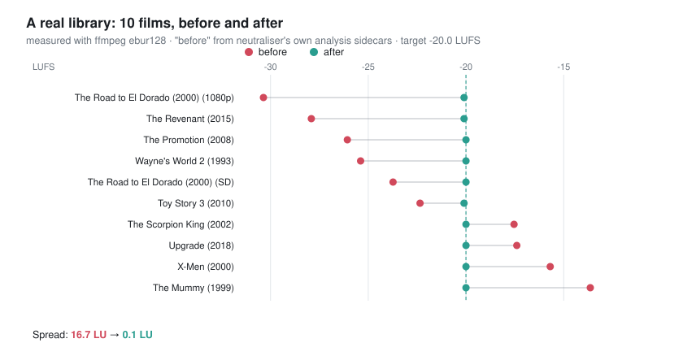
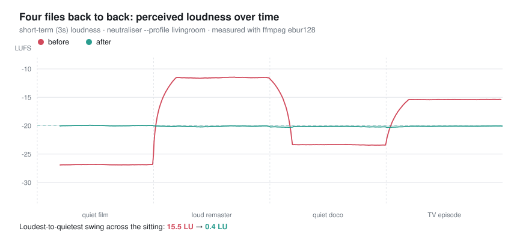
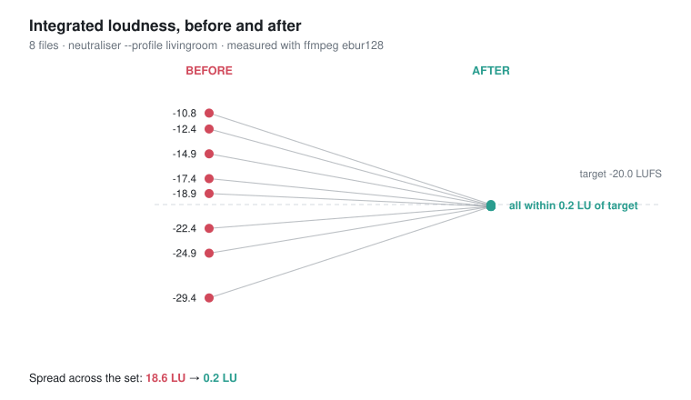

# Neutraliser

[](https://github.com/willhs/neutraliser/actions/workflows/ci.yml)

**Stop reaching for the remote between every film.** Neutraliser levels the audio across your whole video library — one CLI, no server, no database, no plugin marketplace.

It measures each file with FFmpeg's EBU R128 `loudnorm` filter and moves it to the same perceived loudness with one constant gain. Video is stream-copied, and only the track being levelled is re-encoded, at the source's own codec and bitrate. Re-encoding lossy audio still costs a generation, so files already close to target are left alone.

```bash
neutraliser process /media/movies --profile livingroom
```

## What it actually does

Ten films from a real 800-film Plex library, before and after — **16.7 LU of spread reduced to 0.1 LU**:



Nothing here is staged. The "before" figures are what Neutraliser recorded in its own
analysis sidecars when it first saw each file; the "after" is an independent `ebur128`
measurement of those same files. `demo/real_library.rb` builds this from any
library Neutraliser has run over — [the method is documented](demo/README.md).

> **Read this as a result from v0.1's first runs (August 2026), not a promise about
> the current defaults.** Those runs used two-pass `loudnorm`, which picks constant
> gain or dynamic compression per file and doesn't record which. Since then constant
> gain has become the default: it never compresses, but it is capped at the profile's
> −1.5 dBTP ceiling, so a quiet-but-peaky film now lands *short* of −20 LUFS (and the
> log says by how much) unless you opt in to `--limit-db` or `--allow-dynamic`. The ten
> films were also picked from files that had been processed, not at random. Expect
> loud-to-quiet jumps to shrink a lot; don't expect every file at −20.0.

Across that library in August, **716 of 804 films (89%) sat within 1 LU of the target**.
That count predates the constant-gain default, so it isn't what a fresh run of today's
defaults is guaranteed to give. The remainder were files added after the run, which is
what `--resume` and the skip-already-normalised stamps are for.

Four **synthetic** clips (pink noise, not films) played back to back — the loud clip after the quiet one is the moment you reach for the remote:



And the same again on synthetic clips, if you'd rather run it yourself than trust someone else's library — 8 files spread over ~19 LU:



Re-run on 2026-11-01 with the current constant-gain default: the eight synthetic clips
measured **18.6 LU → 0.2 LU** integrated spread; the four-clip playlist measured
**15.5 LU → 0.3 LU** short-term swing. These steady pink-noise clips have enough peak
headroom to reach target; they don't demonstrate quiet, peaky films. A separate synthetic
transient test reached −36.3 LUFS with a −1.5 dBTP peak, confirming that the peak cap
can leave quiet material short of −20 LUFS ([measurements](demo/README.md#verified-synthetic-rerun)).
Don't take the charts' word for it. [`demo/run.rb`](demo/README.md) and
[`demo/ab.rb`](demo/README.md) regenerate both from scratch, `--source ~/media/movies`
runs them over your own library (on copies; originals untouched), and `ab.rb` also
writes `before.mkv`/`after.mkv` so you can *listen* rather than squint at a line.
Loudness is measured with ffmpeg's `ebur128` filter, not the `loudnorm` filter
Neutraliser uses to decide — so it isn't grading its own homework.

**On a real film clip** at −34.9 LUFS (a 14.7 LU boost — the kind of correction where
artifacts would show up if they were going to):

| | before | after |
|---|---|---|
| Integrated loudness | −34.9 LUFS | −20.2 LUFS |
| Loudness range (LRA) | 12.5 LU | **12.5 LU** — unchanged |
| True peak | −17.8 dBFS | −3.0 dBFS — still clear of the −1.5 dBTP ceiling |
| Audio codec | AAC 162k | AAC 162k |
| Video bitstream | — | **MD5-identical**, stream-copied |

Constant gain, not compression, by default: the dynamic range is preserved exactly, so quiet
scenes stay quiet relative to loud ones. Only the overall level moves. The gain is capped so
true peak stays under the profile ceiling, so a quiet-but-peaky file lands shy of target
(and the run log says by how much) rather than being squashed. Compression is opt-in:
`--allow-dynamic`, or the `night` profile.

## Why this exists

Plex's own "Normalize Multi-Channel Audio" setting doesn't fix it — it doesn't touch dynamic range within a file and doesn't apply to every client. The usual workarounds are client-side band-aids (soundbar night mode, Windows loudness equalisation) or a full transcode-automation platform like Tdarr, which people accurately describe as powerful but annoying to set up for one job.

Neutraliser does the one job: make the library level, leave everything else alone.

## Features

- **Whole-library levelling** — point it at a directory; it walks it, analyses, and normalises
- **Home-theatre profiles** — `reference`, `livingroom`, `night`, tuned for how you're actually listening
- **Source-matched codec & bitrate** — AAC stays AAC at its own bitrate and FLAC stays lossless, with no fixed 256k target. Very low and very high bitrates move to a sensible floor or cap (128k MP3 becomes 192k, stereo AAC tops out at 320k). A lossy re-encode is still one generation of loss ([ADR-0001](docs/design/adr/0001-smart-codec-selection.md))
- **Full stream preservation** — every audio and subtitle track, attachments (subtitle fonts), per-stream metadata (titles, languages), chapters and dispositions survive the round trip, and the original isn't replaced if any go missing. Data streams other than a MOV timecode aren't carried over
- **Won't silently strip Atmos / DTS:X** — ffmpeg can't re-encode object audio, so files whose primary track is Dolby Atmos (E-AC3 JOC, TrueHD) or DTS:X are skipped and logged; `--allow-object-audio-loss` processes them anyway. Detecting them needs **FFmpeg 7.1+**. On anything older you get a warning at the start of each run and files *named* as Atmos are skipped, but an unnamed E-AC3 Atmos track can't be told apart from plain E-AC3 and would be flattened ([detection notes](docs/research/object-audio-detection.md))
- **Safe by default** — writes `*_normalized` copies; originals untouched unless you pass `--replace`. Output is written under a hidden temporary name, checked against the source, then renamed into place, and a file that changes during the run is left alone
- **Fully reversible on request** — `--keep-original-audio` stream-copies the untouched original track into the output as a non-default extra track, so nothing is lost even with `--replace`
- **Every change is recorded** — the normalised track carries `NEUTRALISER_*` tags (profile, linear/dynamic, gain, source codec, measured loudness, date), so the record survives moves and renames; `neutraliser report` reads it back. The exceptions are AVI, and MP4 files with cover art or descriptive tags, where writing them would cost the iTunes tags. Those are recorded in the sidecar only
- **Skips what's already fine** — a file tagged for the same profile is never re-encoded and a `.neutraliser` sidecar caches that check, so a re-run over a processed library costs seconds, not hours
- **Resumable** — interrupted a 500-file run? `--resume` picks up from the manifest, which is written as each file finishes
- **Plex-aware** — `analyze-plex` gives a quick loudness triage across your Plex libraries before you change a single file
- **Big-batch friendly** — `--fast` (single-pass, ~30% quicker) and `--local-stage` for slow network mounts

## Requirements

- **Ruby** 3.2+
- **FFmpeg** with `ffprobe` on your `PATH`. Tested on 5.1 and 7.1; **7.1 or newer** is what detects Atmos / DTS:X
- *(Optional)* a Plex token in `.env` for `analyze-plex`

Check FFmpeg with `ffmpeg -version`. On macOS: `brew install ffmpeg`. On Debian/Ubuntu: `sudo apt install ffmpeg`, though many releases ship older than 7.1, in which case the Docker image is the easy way to get it.

## Installation

Neutraliser is **run from source** for v0.1 — it isn't on RubyGems yet.

```bash
git clone https://github.com/willhs/neutraliser.git
cd neutraliser
bundle install
bundle exec neutraliser --help
```

Every example below is written as `neutraliser …`; prefix with `bundle exec` when running from the clone.

<details>
<summary>Prefer a real <code>neutraliser</code> on your PATH?</summary>

Build and install the gem locally:

```bash
gem build neutraliser.gemspec
gem install ./neutraliser-0.1.0.gem
neutraliser --help
```

</details>

### Run with Docker

No Ruby needed. The image bundles Ruby 3.2 and FFmpeg 7.1+ (required for Atmos/DTS:X detection) and is published to GHCR on every push to `main`:

```bash
docker run --rm -v /path/to/media:/media ghcr.io/willhs/neutraliser:latest \
  process --replace --resume /media/movies
```

- **Media volume**: mount your library at `/media`; the working directory is `/media`, and sidecars and the `.neutraliser-run-manifest.jsonl` are written next to the files, so the mount must be writable.
- **File ownership**: the image runs as root by default, so copies, sidecars and the manifest come out owned by root (`--replace` keeps each file's owner). Add `--user $(id -u):$(id -g)` to write as yourself. Logs then go to stdout only, and each run starts with a harmless `Warning: not keeping a log file (Permission denied @ dir_s_mkdir - /.local)`.
- **`--resume`**: skips files already completed in the manifest, so a stopped container can be re-run with the same command. `docker stop` stops cleanly: the original stays as it was and the temp output is removed.
- **Timeouts**: pass `-e NEUTRALISER_ANALYSIS_TIMEOUT=3600` (also `NEUTRALISER_NORMALIZATION_TIMEOUT`, `NEUTRALISER_QUICK_TIMEOUT`, `NEUTRALISER_PROBE_TIMEOUT`, in seconds) for slow storage such as NAS disks.
- **Build it yourself**: `docker build -t neutraliser .`

A RubyGems release (and possibly a Homebrew tap) will follow once v0.1 has had some real-world mileage — see [CHANGELOG.md](CHANGELOG.md).

## Quick start

```bash
# See what a file's loudness actually is — changes no media
neutraliser process --dry-run movie.mkv

# Normalise one file (writes movie_normalized.mkv alongside it)
neutraliser process movie.mkv

# Normalise a whole library
neutraliser process /media/movies

# ...in place, once you trust it
neutraliser process --replace /media/movies
```

`process` is the default command, so `neutraliser movie.mkv` works too.

## Examples

**Audit before you commit.** Get a rough sense of the spread across a Plex library:

```bash
neutraliser analyze-plex --library "Movies" --output-format table
```

Treat the output as a rough triage tool, not a verdict — it judges each title from a
60-second sample, which can sit several LU from the film's true integrated loudness.
`process` measures files in full.

**Dry-run a directory** to see which files would be touched and by how much:

```bash
neutraliser process --dry-run /media/tv/some-series
```

**Level a large library overnight**, in place, at the faster single-pass setting (always compresses, so it needs `--allow-dynamic`):

```bash
neutraliser process --replace --fast --allow-dynamic /media/movies
```

**Resume after an interruption** — a dropped SMB mount, a reboot, a Ctrl-C:

```bash
neutraliser process --replace --fast --allow-dynamic --resume /media/movies
```

**Night listening** — a tighter dynamic range so quiet dialogue stays audible without explosions waking the house:

```bash
neutraliser process --profile night --replace /media/movies
```

**Hit an exact LUFS target** instead of a named profile:

```bash
neutraliser process --target-level -18.0 movie.mkv
```

**Be stricter about what counts as "already fine"** (default tolerance is 1.0 LU):

```bash
neutraliser process --tolerance 0.5 /media/movies
```

**Processing over a slow or high-latency mount?** Stage files to local disk first:

```bash
neutraliser process --local-stage --replace /mnt/nas/movies
```

**Re-run over an already-levelled library.** Sidecars make this cheap, so it suits a cron job that catches newly added files. A file still being copied in is left alone (it fails with `source_changed`) and picked up next time. Use `--lock-file` so a slow run and the next one don't overlap:

```bash
neutraliser process --replace --lock-file /tmp/neutraliser.lock /media/movies
```

## Profiles

| Profile | Target | True peak | LRA | Use it for |
|---|---|---|---|---|
| `reference` | −23 LUFS | −1.5 dBTP | unlimited | Full home-theatre / AVR setups where you want the mix's original dynamics |
| `livingroom` *(default)* | −20 LUFS | −1.5 dBTP | 12 | TVs and soundbars — general viewing. Start here |
| `night` | −16 LUFS | −1.5 dBTP | 10 | Quiet listening: louder overall, compressed range, no explosive peaks. A compression profile — implies `--allow-dynamic` |

Higher (less negative) LUFS = louder. Lower LRA = less difference between the quietest and loudest moments.

```bash
neutraliser profiles --verbose
```

Any numeric `--target-level` overrides the profile's LUFS while keeping the rest of its settings.

## How it works

1. **Skip check** — a file whose primary audio track (or container) carries a `NEUTRALISER_PROFILE` tag for this profile has already been done, wherever it lives now. A `.neutraliser` sidecar (size + mtime + profile) caches that answer.
2. **Measure** — an FFmpeg `loudnorm` analysis pass measures integrated loudness, true peak, and loudness range. Results are cached, so re-analysis is free.
3. **Decide** — within `--tolerance` of the profile target? Skip it. Otherwise, pick an output codec that matches the source ([ADR-0001](docs/design/adr/0001-smart-codec-selection.md)).
4. **Normalise** — applies a constant gain (an ffmpeg `volume` filter) computed from the measured values, capped so true peak stays within the profile ceiling. With `--allow-dynamic` (or the `night` profile) a second `loudnorm` pass is used instead, which may fall back to dynamic compression. Video is stream-copied — it is never re-encoded. Chapters, subtitles, and per-stream metadata are mapped across explicitly.
5. **Write** — to a hidden temporary file beside the target. Duration, every stream, chapters and the track's channel count are checked against the source, then one rename puts it at `*_normalized.<ext>`, or over the original with `--replace`. Through a symlink, `--replace` updates the real file and keeps the link. It does break hard links: the old copy stays under its other names, so a library hard-linked to a torrent client's folder takes up the space twice. The same ffmpeg pass writes the `NEUTRALISER_*` tags ([tag schema](docs/ops/data_contracts.md)), and the sidecar is updated.

Use `--fast` (requires `--allow-dynamic` or the `night` profile) to collapse steps 2 and 4 into a single dynamic-mode pass: roughly 30% quicker, marginally less precise ([ADR-0002](docs/design/adr/0002-performance-flags.md) has the benchmarks).

## Commands

### `process PATH`

Normalise a file or every video under a directory.

| Option | Default | Description |
|---|---|---|
| `--profile` | `livingroom` | `reference`, `livingroom`, or `night` |
| `--target-level` | — | Explicit LUFS target, overriding the profile |
| `--tolerance` | `1.0` | Skip files already within this many LU of target |
| `--replace` | `false` | Overwrite originals instead of writing `*_normalized` copies |
| `--dry-run` | `false` | Analyse and report only; no media changes. It leaves its measurements in `*.loudnorm_*.json` caches so the real run doesn't repeat them, but writes no run manifest |
| `--cache` / `--no-cache` | on | Cache loudness analysis results |
| `--fast-verify` / `--no-fast-verify` | off | Skip a file when a 30-second sample from its middle looks within tolerance. Saves a full measurement, but a sample can misjudge a whole film, and the file is then recorded as finished |
| `--resume` | `false` | Skip files already finished per `.neutraliser-run-manifest.jsonl` under the same profile, target and `--replace` setting. Everything else is checked again |
| `--allow-dynamic` | `false` | Let `loudnorm` compress dynamics when it needs to. Default is constant gain only. Implied by the `night` profile |
| `--keep-original-audio` | `false` | Keep the untouched original primary audio as an extra, non-default track titled `<title> (original, not normalised)`, after the normalised one. Costs file size; makes processing reversible. A re-run never adds a second copy |
| `--allow-object-audio-loss` | `false` | Process files whose primary track is Atmos / DTS:X anyway. Re-encoding drops the object audio (plain 5.1/7.1 out); each such file logs a warning. Default skips them with reason `object_audio` |
| `--min-gain` | `--tolerance` | A peak-capped file is re-encoded only if the gain **towards** target is at least this many dB; otherwise skipped (`peak_limited`) |
| `--limit-db` | `0` | Let a peak limiter take up to N dB off overshooting peaks so quiet-but-peaky files can reach target. Off = strict constant gain. Such files are stamped `limited` and reported; not combinable with `--allow-dynamic`/`--fast`/`night` |
| `--allow-codec-change` | `false` | Process files whose codec can't be re-encoded to itself (DTS, TrueHD ... become FLAC/E-AC3). Default skips them with reason `codec_change` |
| `--min-free-gb` | off | Skip a file while the output volume has less than N GiB free (or less than the file's size); reason `low_disk` |
| `--abort-free-gb` | off | Stop the run, exit `4`, when the output volume has less than N GiB free |
| `--lock-file` | off | One run at a time per lock file; exit `3` if another run holds it |
| `--fast` | `false` | Single-pass normalisation — quicker, always dynamic, so it errors unless `--allow-dynamic` or `night` is set |
| `--local-stage` | `false` | Copy to local disk before processing; helps on slow mounts |
| `--linear-only` | `false` | Deprecated no-op (constant gain is now the default); prints a warning |

The run summary reports `linear=N, dynamic=N, limited=N` counts; each file that went Dynamic logs a warning, and each peak-capped file logs how many LU it landed short of target.

Exits `1` if any file fails, so batch runners can detect partial failure, `3` if `--lock-file` is held by another run, `4` if the run stopped on `--abort-free-gb`, and `130` or `143` if stopped by Ctrl-C or SIGTERM.

Each run also logs to `~/.local/share/neutraliser/logs/`, when that's writable.

A run killed with SIGKILL, or a power cut, can leave a hidden `.<name>_neutraliser_<hex>.<ext>` file behind. The next run over that folder lists any it finds, and they're safe to delete once no run is active.

`neutraliser import-manifest MANIFEST --root DIR` marks files that the retired `neutralise.sh` already leveled (its `manifest.jsonl`) as processed, so a first run doesn't re-measure them. See the [parity audit](docs/research/prod-parity-audit-2026-10.md).

**Large files on slow mounts.** Measuring and normalising each decode the whole
audio stream, and both are allowed 30 minutes by default. If you hit
`timed out after 1800s` on very large files or a slow mount, raise the limits:

```bash
NEUTRALISER_ANALYSIS_TIMEOUT=3600 NEUTRALISER_NORMALIZATION_TIMEOUT=3600 \
  neutraliser process /media/tv
```

### `analyze-plex`

Loudness triage across your Plex movie and TV libraries, modifying nothing. Reads audio over Plex's own stream, so it doesn't need filesystem access to the media. TV libraries are read episode by episode (`Show S01E02 Title`).

**How well tested:** movie libraries have been measured against a real Plex server. TV libraries are covered only by a fake Plex server in the specs (`spec/plex_fake_server_spec.rb`), so report anything odd on a real one.

**What it can and can't tell you:** by default each title is *sampled* (five 60-second windows spread across the runtime, combined on energy), and a sample can't support a ±1 LU verdict. Measured against full readings on 10 real films, five windows read up to 6.5 LU quieter (and once 1.0 LU louder) than the truth and were within 1 LU on only half of them ([the numbers](docs/research/plex-sampling-error-2026-10.md)). So a sampled title gets a verdict ("Too Loud" / "Too Quiet") only when its whole error range is clear of the tolerance band; everything else is reported as **Unclear**, with the range the true level could be in. Use `--full` to measure each title end to end (what `process` sees): accurate, but it reads the whole file over HTTP, about 2 to 7 minutes per film.

| Option | Default | Description |
|---|---|---|
| `--server-url` | `http://localhost:32400` | Plex server URL |
| `--token` | `$PLEX_TOKEN` | Plex auth token (falls back to `.env`) |
| `--library` | all video libraries | Restrict to one library |
| `--output-format` | `table` | `table`, `csv`, or `json` |
| `--sample-percent` | `100` | Analyse only N% of files — useful on huge libraries |
| `--profile` | `livingroom` | Profile to measure against |
| `--tolerance` | `1.0` | Files within this many LU count as OK |
| `--full` | off | Measure every title end to end instead of sampling. Slow; gives a firm OK / Too Loud / Too Quiet for each |

Copy `.env.example` to `.env` and add your token. Only `analyze-plex` reads that file, and only `PLEX_TOKEN` and `PLEX_SERVER_URL` from it, so a stray `.env` in a media folder does nothing. The token is passed to ffmpeg as a request header, so while a title is being sampled it is visible in `ps` to other users on the same machine. See [docs/design/plex-analysis-guide.md](docs/design/plex-analysis-guide.md).

### `report PATH`

Reads the `NEUTRALISER_*` tags from every video under PATH (or one file) with ffprobe and changes nothing. By default it prints counts: normalised linear, normalised dynamic, untouched, and the profile mix.

| Option | Default | Description |
|---|---|---|
| `--format` | `summary` | `summary` (counts), `tsv` (one row per file on stdout, counts on stderr) or `json` (counts plus every file's tags) |

```bash
neutraliser report /media/tv
neutraliser report /media/tv --format tsv > tv-report.tsv
```

AVI can't hold custom tags, and MP4 files with cover art or descriptive tags keep their iTunes tags rather than take ours, so these always show as untouched. Their skip state lives only in the sidecar.

### `profiles`

List the built-in profiles and their targets. `--verbose` adds descriptions.

### `cache`

- `neutraliser cache stats PATH` — cache counts and storage for a directory
- `neutraliser cache clean PATH [--max-age DAYS]` — drop cache entries older than `--max-age` (default 30)

### `version`

Print the installed version.

## Alternatives

Worth knowing about, because they may fit you better:

- **[ffmpeg-normalize](https://github.com/slhck/ffmpeg-normalize)** — the general-purpose loudness normaliser. More normalisation algorithms (EBU R128, RMS, peak), a Python API, and it handles audio files as well as video. Reach for it if you want a flexible library rather than a library-levelling tool; Neutraliser is narrower and knows about Plex, home-theatre profiles, and resumable batch runs.
- **[Tdarr](https://github.com/HaveAGitGat/Tdarr)** / **Unmanic** — full transcode-automation platforms with a server, worker nodes, a database, and a plugin ecosystem. Normalisation is achievable via a community flow. Excellent if you want a general library-processing pipeline; heavy if all you want is level audio.
- **[sickbeard_mp4_automator](https://github.com/mdhiggins/sickbeard_mp4_automator)** — Sonarr/Radarr post-processing that standardises containers, codecs, and tags, with normalisation as one feature among many.

## Development

CI runs RSpec (including real-media round trips) against static FFmpeg 4.2.2 and 7.1 builds on Ruby 3.2, plus RuboCop. Existing lint debt is recorded in `.rubocop_todo.yml`; remove exclusions as it is cleaned up.

```bash
git clone https://github.com/willhs/neutraliser.git
cd neutraliser
bundle install
bundle exec rspec
bundle exec rubocop
```

Architecture, design decisions, and benchmarks live in [`docs/`](docs/index.md) — start with [docs/design/architecture.md](docs/design/architecture.md).

## Contributing

Issues and pull requests are welcome. Bug reports are most useful with the FFmpeg version (`ffmpeg -version`), the command you ran, and the source file's audio codec (`ffprobe -hide_banner file.mkv`).

## Licence

[MIT](LICENSE) © Will Hardwick-Smith
